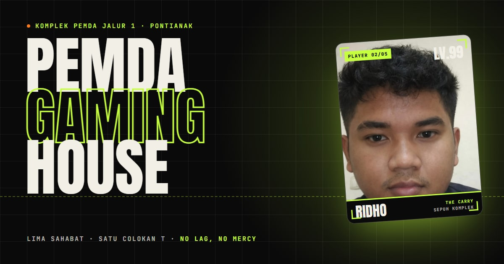

# PEMDA GAMING HOUSE

Markas digital lima sahabat dari **Komplek Pemda Jalur 1, Pontianak**: Daffa, Ridho, Agung, Jojo, dan Abip.
Studio esports kelas dunia (versi tongkrongan komplek): no lag, no mercy, banyak es teh.



## Fitur

- **Preloader** ala loading screen game: counter 000–100 mengikuti progres asli (font, foto, scene 3D), tips lucu, lalu transisi wipe.
- **Hero 3D**: judul raksasa per karakter, kartu pemain Ridho sebagai plane WebGL (tilt, ripple, RGB-split, HUD), aset gaming prosedural (gamepad, keycap P-E-M-D-A, headset, koin, kristal, dadu inisial) yang melayang, bereaksi ke mouse, dan ber-parallax saat di-scroll.
- **Marquee** dua pita bersilang; kecepatan & arahnya mengikuti kecepatan scroll.
- **Manifesto**: kata-kata menyala bertahap saat di-scroll.
- **Squad**: layar "player select" dengan scroll horizontal ter-pin, kartu tilt 3D + glare, stat bar beranimasi, placeholder "NO SIGNAL" untuk anggota yang belum ada fotonya.
- **Spotlight Ridho**: parallax berlapis (teks outline di belakang, foto dengan wipe reveal shader di tengah, objek 3D di depan).
- **Arsenal**: daftar game; hover memunculkan aset 3D yang mengikuti kursor.
- **The House**: radar ala HUD (garis khatulistiwa, Sungai Kapuas), jam WIB realtime, counter hari tongkrongan.
- **Stats** blok lime dengan angka yang menghitung, **Galeri** polaroid yang bisa di-drag, **Footer CTA** dengan tiket antrian.
- Cursor kustom, tombol magnetik, scroll progress, smooth scroll (Lenis), easter egg (**klik logo 5x**).
- Responsif, `prefers-reduced-motion` dihormati (versi statis), fallback DOM bila WebGL tidak tersedia, aksesibel (semantic HTML, focus ring, skip link, menu mobile dengan `inert`).

## Tech stack

| Bagian   | Pilihan                                                                               |
| -------- | ------------------------------------------------------------------------------------- |
| Build    | Vite 8 (Rolldown) + React 19 + TypeScript (strict)                                    |
| Styling  | Tailwind CSS v4 (token di `@theme`, `src/styles`)                                     |
| 3D       | three 0.182 + @react-three/fiber 9 + @react-three/drei (aset prosedural, tanpa model) |
| Animasi  | GSAP 3 + ScrollTrigger + @gsap/react, Lenis untuk smooth scroll                       |
| Font     | Anton, Space Grotesk, JetBrains Mono (self-host via Fontsource, di-preload)           |
| Kualitas | ESLint (typescript-eslint, react-hooks v7) + Prettier                                 |

## Menjalankan

Butuh Node.js **20.19+** (atau 22.12+).

```bash
npm i            # install dependency
npm run dev      # dev server → http://localhost:5173
npm run build    # typecheck + build produksi ke dist/
npm run preview  # cek hasil build → http://localhost:4173
npm run lint     # ESLint
npm run format   # Prettier (format:check untuk cek saja)
```

Parameter URL untuk pengujian: `?gl=off` (paksa versi tanpa 3D) dan `?gl=force` (paksa 3D walau renderer software).

## Mengganti konten

**Semua teks, angka, dan foto ada di [`src/data/content.ts`](src/data/content.ts).** Bagian bertanda `TODO` masih placeholder lucu-lucuan: ganti dengan data asli geng.

| Mau ganti apa                     | Di mana                                               |
| --------------------------------- | ----------------------------------------------------- |
| Role, tagline, game, stat anggota | `MEMBERS`                                             |
| Bio/quote/callout Ridho           | `RIDHO_PROFILE`                                       |
| Daftar game                       | `GAMES` (`asset` = aset 3D yang muncul saat hover)    |
| Angka statistik                   | `STATS`                                               |
| Tanggal geng berdiri              | `SITE.foundedOn` (dipakai counter "hari tongkrongan") |
| Foto galeri & caption             | `GALLERY`                                             |
| Link sosial media                 | `FOOTER.socials` (biarkan `#` kalau belum ada)        |

### Foto Ridho

Foto ada di `public/images/ridho.jpg`. Untuk mengganti, **timpa file itu dengan nama yang sama**: semua section (hero 3D, squad, spotlight, galeri) langsung ikut berubah tanpa ubah kode.

> Catatan: foto yang sekarang punya teks **"MAN 1"** tertanam di area dagu. Teks itu sengaja ditutup banner nama di semua frame (`RIDHO_PHOTO.crop.banner`). Kalau punya versi foto yang bersih, timpa saja; kalau komposisi fotonya beda, sesuaikan `RIDHO_PHOTO.crop` (`top`, `height`, `centerX`) lalu cek tampilannya di semua section.

Tips: kompres dulu foto (lebar maks ±1600px, JPG kualitas ±80), misalnya lewat [squoosh.app](https://squoosh.app).

### Foto anggota lain

1. Taruh fotonya di `public/images/`, misalnya `public/images/daffa.jpg`.
2. Di `MEMBERS`, isi field `photo` untuk anggota tersebut:

```ts
photo: {
  src: '/images/daffa.jpg',
  alt: 'Potret Daffa, Player 01 PEMDA GAMING HOUSE',
  width: 1080, // ukuran asli foto
  height: 1350,
  crop: { top: 0.1, height: 0.75, centerX: 0.5, banner: 0 },
},
```

Placeholder "NO SIGNAL" otomatis diganti foto. Untuk galeri, isi `photo` di item `GALLERY` dengan cara yang sama.

## Struktur folder

```
src/
├─ components/   # UI reusable: Preloader, Navbar, Cursor, PlayerCard, MagneticButton, Radar, …
├─ sections/     # 12 section halaman: Hero, Marquee, Manifesto, Squad, Spotlight, Arsenal, …
├─ three/        # Scene R3F (lazy), PhotoPlane + shader, aset prosedural, material, tekstur canvas
├─ hooks/        # useMediaQuery, useInView, useMagnetic, useTilt, useClock, useDragScroll, …
├─ lib/          # gsap setup, motion store, smooth scroll (Lenis), loader, deteksi device, crop foto
├─ data/         # content.ts: SATU-SATUNYA sumber konten
└─ styles/       # Tailwind v4 tokens + efek (grain, glitch, radar, cursor)
public/          # foto, favicon, og-image, manifest
scripts/         # generator environment map 3D (dev only)
```

## Catatan performa

- Scene 3D di-lazy-load (chunk `vendor-three` ±240 KB gzip) sehingga muatan awal hanya ±145 KB gzip.
- Shader dikompilasi paralel (`compileAsync`) sebelum frame pertama; environment map refleksi sudah dipanggang jadi PNG 45 KB (`src/three/studio-env.png`). Untuk membuat ulang: `npm run dev` → buka `/scripts/bake-environment.html` → simpan hasilnya menimpa file tersebut.
- Render 3D berhenti saat section-nya di luar layar; DPR dibatasi 1,5; objek dikurangi di ponsel/perangkat lemah. Perangkat tanpa akselerasi GPU otomatis memakai versi DOM.
- Lighthouse desktop (laptop GPU integrated): Performance 85–93, Accessibility 100, Best Practices 100, SEO 100.

## Deploy ke Vercel

Proyek sudah siap deploy (`vercel.json` berisi SPA rewrite + header cache). Tidak ada environment variable wajib.

**Lewat dashboard (paling mudah)**

1. Push repo ke GitHub.
2. Buka [vercel.com/new](https://vercel.com/new), pilih **Import** repo `pemda-gaming-house-website`.
3. Framework Preset: **Vite** · Build Command: `npm run build` · Output Directory: `dist`.
4. Klik **Deploy**.
5. Karena pekerjaan ada di branch `dev`: ubah **Production Branch** ke `dev` di Project Settings (menu **Environments → Production → Branch Tracking**, atau **Git** di versi dashboard lama), lalu redeploy. Alternatifnya, merge `dev` ke `main`.

**Lewat CLI**

```bash
npx vercel login
npx vercel --prod
```

Opsional: set env `SITE_URL` (mis. `https://pemdagaminghouse.com`) bila memakai domain sendiri. Tanpa itu, URL Open Graph otomatis memakai domain produksi Vercel.

## Lisensi & kredit

Kode untuk geng PEMDA GAMING HOUSE. Font Anton, Space Grotesk, dan JetBrains Mono berlisensi SIL Open Font License. Semua aset 3D dibuat prosedural dari primitif three.js.

Made with ♥ in Pontianak.
